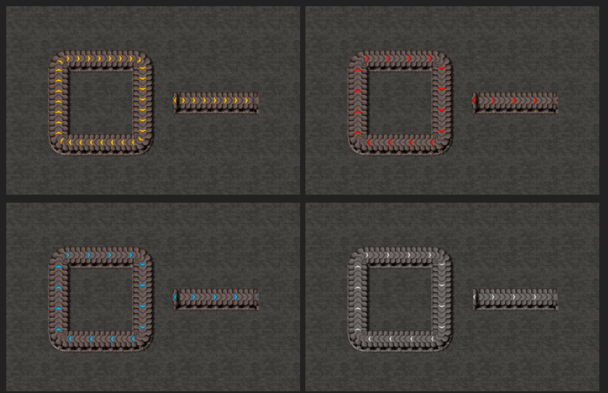

# Rocket Route Blueprints

An offline, single-file HTML tool that generates a Factorio Space Exploration blueprint book for an automated ore rocket route: a Nauvis supply sender, an outpost on a planet/moon/orbit, and a receiver on Nauvis or in Nauvis orbit.

Pick your planet and raw material, copy the generated string, and import it in-game. The outpost launches whenever the rocket is full and requests its own resupplies from Nauvis.


Built for Factorio 2.0.77 and Space Exploration 0.7.57, using AAI Containers, AAI Signal Transmission, and Zithorian extra storage tanks.

## What's in the book

1. **Nauvis supply sender** — Loads a supply rocket with whatever the outpost is short on (fuel, packed cargo sections, capsules, mining fluid) and launches it.
2. **Launch outpost** — Buffers ore in two warehouses so mining doesn't stall while a rocket is in flight, refines fuel items into liquid rocket fuel, and launches when full.
3. **Receiver** — Landing dock, ore provider, and a storehouse that feeds recovered parts back into your logistics network. Works on Nauvis or in orbit (includes space belts and scaffolding).

### A few design notes

- Fuel requests are calculated from your refinery productivity level rather than guessed: `ceil((reserve x launch fuel - stock) / liquid per item) + margin`.
- Capsules and cargo sections are only requested when stock drops below the reserve, and three valve inserters ship any extras back home on the next ore rocket so they don't pile up at the outpost.
- Status lights and displays show what a pad is waiting on (missing fuel, pad parts, or ore, non-empty dock, unfilled requester chest, stale wire, etc.).
- Configurable for planet, moon, or space outposts, 1–6 refineries, different belt tiers, mining fluid via barrels or on-site chemical plants (sulfur + plates), and optional debug displays.
- Includes an interactive preview with zoom, pan, hover tooltips, animated belts, and a parts list.



## Usage

```bash
node src/build.js
```

This writes `dist/rocket-route-blueprints.html`. Open it in your browser (no server or internet connection needed), copy the blueprint book string, and paste it into Factorio via **Blueprint library -> Import string**.

In-game placement order:
1. Place the **receiver**.
2. Place the **outpost**, check the "fuel required" number in its launch pad window, enter that into the tool, and re-copy the book.
3. Place the **Nauvis sender**. If you're replacing an older sender on the same route, deconstruct the old one first—pasting directly over it leaves old circuit wires behind (see [docs/DESIGN.md](docs/DESIGN.md), "The stale wire bug").

## Game artwork (optional)

No Factorio or Space Exploration sprites are included in this repo. Without them, the tool still works fine, but the preview falls back to flat boxes, chevron belts, and blank icons (`node src/build.js` will print what's missing).

If you want the full sprites for your own local copy, you can build them from your own game installation:

```bash
export FSX_ROOT=/path/to/server-or-install   # expects runtime/windows/data, mods/, and agent-kit/sprites
python src/make_belts.py png                 # animated belts from base game + SE graphics
python src/make_assets.py /path/to/fonts     # icons, machine sprites, floor tiles (fonts are optional)
node src/build.js
```

`make_belts.py` only needs the base game data and the SE graphics mod zip. `make_assets.py` also expects machine sprites captured from a running game using a private toolkit that isn't in this repo, so it won't work out of the box. Please don't redistribute the generated HTML if you bundle game assets into it.

The UI uses Titillium Web (SIL Open Font License 1.1); `.woff2` font files are not included.

## Repo layout

- `src/bpgen.js` — blueprint generator (layouts, circuit logic, wiring, validation, BOM, fuel math)
- `src/tool.src.html`, `src/style.css` — web UI template and styles
- `src/build.js` — bundles everything into the standalone HTML file
- `src/make_belts.py`, `src/make_assets.py`, `src/ents.json` — optional asset scripts
- `src/test/` — headless stress-test rig (see below)
- `docs/DESIGN.md` — architecture notes, test data, and known limits

## Testing

Every generated blueprint runs through a static check for entity overlaps, inserter reach, and power coverage.

The layouts were also stress-tested in headless Factorio 2.0.77 with the full mod list on a copy of a real save at 100x speed: 7 routes running in parallel for 90 game-minutes with real pads, docks, AAI signal transmitters, warehouses, combinators, and bots. That run completed 120 ore launches and 149 supply launches (~985,000 ore delivered), with capsule and section stocks staying bounded and fault cases (stalled receiver, Nauvis fuel outage) recovering automatically. More details are in [docs/DESIGN.md](docs/DESIGN.md).

Things that were **not** tested:
- Real power draw, Nauvis liquid fuel pipeline throughput/pressure, actual mining rates, or biters
- Runs longer than 90 game-minutes or more than 7 parallel routes (the test rig faked power, Nauvis fuel, and Nauvis cargo-section supply)
- Browsers other than Chrome for the preview (also, the AAI storehouse reuses the warehouse sprite since it has no captured sprite)

`src/test/` depends on a private headless test harness that isn't included here; it's kept in the repo mainly so you can see how the test numbers were gathered.

## License

Code is MIT-licensed (see [LICENSE](LICENSE)). Factorio, Space Exploration, and the mods listed above belong to their respective authors; this project isn't affiliated with or endorsed by them.
