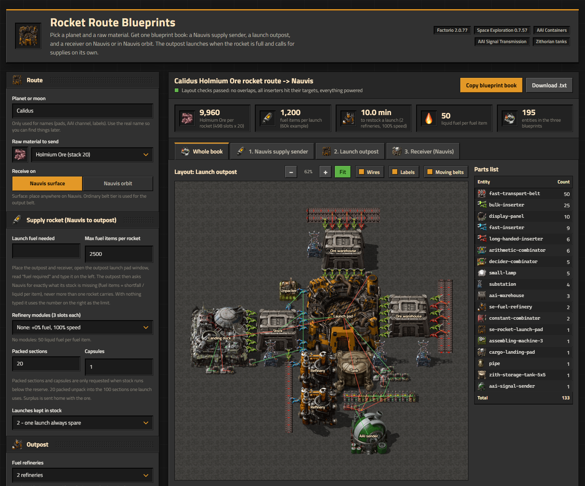

# Rocket Route Blueprints

A single-file, offline tool that generates a **Factorio blueprint book for one rocket route** in Space Exploration:
a Nauvis supply sender, a launch outpost on a planet, moon or in space, and a receiver on Nauvis or in Nauvis orbit.
Pick a planet and a raw material, copy the book, paste it into the game. The outpost launches when the rocket is full and asks Nauvis for supplies on its own.



Built for Factorio 2.0.77 and Space Exploration 0.7.57 with AAI Containers, AAI Signal Transmission and Zithorian extra storage tanks.

## What you get

| Blueprint | What it does |
|---|---|
| **1. Nauvis supply sender** | Loads a supply rocket with exactly what the outpost asked for (fuel, packed sections, capsules, mining fluid) and launches it. |
| **2. Launch outpost** | Two storage warehouses buffer the ore so mining never stops while a rocket is away. Refineries turn fuel items into liquid rocket fuel. The pad launches when full. |
| **3. Receiver** | Landing dock, ore provider, and a storehouse that passes recovered parts into your storage. On Nauvis or in orbit (space belts and scaffold included). |

* **Fuel is computed, not guessed.** Choose a refinery productivity level and the outpost asks only for the shortfall: `ceil((reserve x launch fuel - stock) / liquid per item) + margin`.
* **No piles of spare capsules or sections.** They are requested only when stock is below the reserve, and three valve inserters send any surplus home in the next ore rocket.
* **Lights and displays that say what it is waiting on** (no fuel, no pad parts, no ore, dock not empty, requester chest not filled, stale wire ...).
* Planet, moon or **space outposts**, 1 to 6 refineries, belt tiers, mining fluid as barrels or as sulfur + plates with chemical plants, optional debug displays.
* A preview drawn from the game's own sprites, with moving belts, zoom, pan, hover names and a parts list.


## Use it

```bash
node src/build.js          # writes dist/rocket-route-blueprints.html
```

Open the HTML file in a browser. No server and no network needed. In Factorio: blueprint library, Import string, paste.

Suggested order in the game (the same notes are in the tool): place the receiver, then the outpost (read "fuel required" from its launch pad window, type it into the tool, copy the book again), then the Nauvis sender. If you already have an older sender for the route, deconstruct it first: pasting over it keeps its old wires (see [docs/DESIGN.md](docs/DESIGN.md), "The stale wire bug").

## Game artwork (optional, personal use only)

The repository contains no Wube Software or Space Exploration artwork. Without it the tool works the same but the preview shows flat boxes and chevron belts, and the icons are blank (`node src/build.js` says what is missing).

To get the full look for your own copy, generate the artwork from your own game files:

```bash
export FSX_ROOT=/path/to/server-or-install   # holds runtime/windows/data, mods/ and agent-kit/sprites
python src/make_belts.py png                 # animated belts from the base game and Space Exploration sheets
python src/make_assets.py /path/to/fonts     # icons, machine sprites, floor tiles; fonts are optional
node src/build.js
```

`make_belts.py` needs only the game data and the SE graphics mod zip. `make_assets.py` also reads machine sprites that were captured from the running game by a private toolkit that is not part of this repository, so it will not run for you as is. Treat the generated file as personal: do not redistribute it.
Text is set in Titillium Web (SIL Open Font License 1.1); the woff2 files are not bundled.

## Repository

| Path | What |
|---|---|
| `src/bpgen.js` | the generator: layouts, circuits, wiring, validation, bill of materials, fuel plan |
| `src/tool.src.html`, `src/style.css` | the UI (placeholders are filled in by the build) |
| `src/build.js` | builds the single HTML file |
| `src/make_belts.py`, `src/make_assets.py`, `src/ents.json` | artwork generators |
| `src/test/` | the stress rig (see below) |
| `docs/DESIGN.md` | design notes, test results, known limits |

## How it was tested

The generator validates every blueprint it makes: no overlaps, every inserter hits its targets, everything powered.

The designs were stress tested in headless Factorio 2.0.77 with the full mod set, on a copy of a real save at 100x game speed: 7 different routes in parallel for 90 game-minutes with real launch pads, landing docks, AAI links, warehouses, inserters, belts, combinators and logistic robots.
Result: 120 ore launches and 149 supply launches, about 985,000 ore delivered, and the capsule, loose-section and packed-section stocks at the outposts stayed bounded with no upward trend. Fault runs (receiver stops consuming, Nauvis loses fuel) recovered on their own. Details are in [docs/DESIGN.md](docs/DESIGN.md).

**Not tested:** real power draw, the Nauvis liquid fuel pipeline and its pressure, real mining rates, biters on the outpost, runs longer than 90 game-minutes, and more than 7 routes. The rig faked power, Nauvis fuel and the Nauvis cargo-section supply.
The preview was checked in Chrome only. The AAI storehouse has no captured sprite, so the preview reuses the warehouse sprite.

`src/test/` needs a private Factorio test harness (headless slots, save copies) that is not included; it is here as a record of how the numbers were produced, not as something you can run.

## Licence

The code is MIT licensed (see `LICENSE`). Factorio, Space Exploration and the mods named above belong to their authors; this project is not affiliated with or endorsed by them. The screenshots show their artwork.
